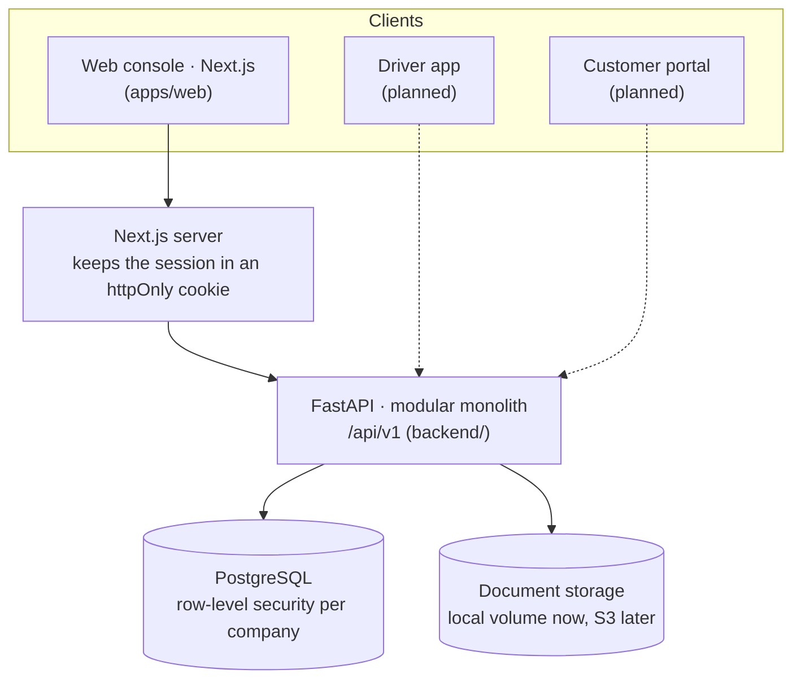

# FlyFleet

**[flyfleet.io](https://flyfleet.io)**

A web-based transportation management system (TMS) for trucking companies, built as multi-tenant software
from day one. One owner profile can run **up to ten companies**, each with its own books, and switch between
them in one click.

> **Status.** The API covers everything in the table below. The web console is **Design 1.0**: the FlyFleet
> design, screen for screen, running on the API. Every record on screen is the signed-in company's own; a new
> company starts empty. Progress is tracked in [docs/roadmap.md](docs/roadmap.md).

## The web console today

The console at app.flyfleet.io is built on the FlyFleet design system, in light and dark, with the role of
the signed-in person deciding what they see. It reads and writes everything through the API.

| Area | Screens |
| --- | --- |
| Overview | Role-aware dashboard (with financials for roles that may see money), Fleet alerts from the API's live exceptions |
| Operations | Dispatch board with the assignment panel (eligibility and conflicts from the API), Loads with the detail drawer, the load's page with every lifecycle action, the guided new-load form |
| Directory | Customers, Drivers and the driver profile with the qualification file |
| Safety and fleet | Compliance matrix, Inspections, Documents and document review, Trucks, Trailers and the unit record, Maintenance board with work orders |
| Finance and analytics | Invoices with receivables aging, driver pay statements, Fuel purchases by state and truck, Reports with CSV export |
| Administration | Team & access (members, roles and the permission matrix), company settings, Audit log |
| Everywhere | Search (⌘K), notifications, Create and edit forms for drivers, trucks, trailers, customers, inspections, invoices, payments, statements, fuel and work orders |
| Outside the console | Sign-up, sign-in, choosing and switching company |

Screens of the design that have nothing behind them in the API yet show an empty state that says so: My
tasks, Live fleet positions, Messages, Owners, Dispatch teams, integrations, alert policies, IFTA returns and
tax rates, and Ask FlyFleet.

How it is built: [apps/web/README.md](apps/web/README.md).

## What the API does today

| Area | Included |
| --- | --- |
| Account and companies | Sign-up, one profile with up to 10 active companies, add a company by copying team, terminals, customers, drivers and equipment from another, archive (read-only) and restore, one-click switch |
| Team and access | Nine roles with a published permission matrix, per-company membership, immediate effect of role changes, password change with session revocation, audit log |
| Directory | Customers with contacts and addresses, drivers with qualification files and pay settings, trucks, trailers, terminals. Licence numbers are encrypted and masked by role |
| Loads | Drafts, multi-stop routes, freight items, accessorial charges, notes, check calls, one enforced lifecycle with an immutable history, optimistic concurrency |
| Dispatch | Board with server-side filters, sorting and paging, summary counts, saved views, eligibility with reason codes, schedule-overlap checks, safe assignment under concurrency, reassignment history |
| Documents | Upload by intent, upload, complete (ready for S3 presigned URLs), content checks, links to any record, review, role-restricted licence and medical scans |
| Safety | Compliance status on every driver and unit, expirations queue, blocking of expired drivers and equipment at assignment and at dispatch |
| Maintenance | Work orders with parts and labour costs, start, complete and cancel; inspections with defects; out-of-service units kept off the dispatch board until returned to service, which is refused while the repair is open |
| Finance | Draft invoices built from completed loads, gapless numbering at issue, immutable issued invoices, void, payments with allocations, unapplied money, reversal, receivables aging |
| Costs and driver pay | Expenses with receipts (fuel with gallons and state, tolls, lumpers, advances and more), fuel by state for fuel tax and by truck with miles per gallon, driver settlements built from delivered loads, driver-payable charges, reimbursements and deductions, approved settlements fixed by the database |
| Insight | Role-aware dashboard, exceptions list, global search, revenue, driver, truck and aging reports with CSV export |
| Driver access | A driver sees and updates only the loads they are hauling, and can add the proof of delivery |

Not built yet: the driver mobile app, the website, ELD, and the AWS infrastructure. In the API: the customer
and owner portals, live tracking, messages, tasks, equipment owners and their settlements, IFTA, dispatch
teams and the assistant. The console shows those screens empty until they exist.

## Architecture in one minute



- **One backend, separate modules**: `organizations`, `customers`, `drivers`, `equipment`, `loads`,
  `dispatch`, `documents`, `safety`, `finance`, `reports`.
- **A company is the unit of isolation, enforced by the database.** The API connects as a restricted role
  and PostgreSQL row-level security hides every other company's rows, including other companies under the
  same owner. The API refuses to start if its database role could bypass these rules.
- **FastAPI owns the rules.** Status changes, eligibility, money and permissions are decided on the server;
  the web app only presents them.
- **The browser never holds the API token.**

Details: [docs/architecture.md](docs/architecture.md). Decisions and their reasons:
[docs/decisions](docs/decisions).

## Run it

You need Docker, and for development Python 3.12 or newer (developed on 3.13) and Node.js 22.

Run these on the computer where you want to use the app: `localhost` in the addresses below means that
machine.

### Trying it

The console needs the API and its database. The quickest way to have all three is the next section; then
create an account at http://localhost:3000/signup, or run `make seed` to create a demo company with sample
records through the API (development only: it prints the sign-in it made).

### Everything in containers

```bash
docker compose --profile app up --build
```

The console is at http://localhost:3000 and the API documentation at http://localhost:8000/api/docs.

### For development (hot reload)

Start PostgreSQL (creates both database roles and the `flyfleet` and `flyfleet_test` databases):

```bash
docker compose up -d
```

Start the API:

```bash
cd backend
python -m venv .venv && source .venv/bin/activate
pip install -r requirements-dev.txt
alembic upgrade head
uvicorn app.main:app --reload --port 8000
```

Start the web app in a second terminal:

```bash
cd apps/web
npm install
npm run dev
```

Load a demo account: two companies, loads at every stage, invoices and payments, work orders and
inspections, fuel and other expenses, and driver pay (one settlement approved, one draft). It prints the
sign-in details:

```bash
cd backend && source .venv/bin/activate
python scripts/seed_demo.py
```

`make help` lists shortcuts.

## Test it

```bash
cd backend && pytest
```

The backend suite runs against a real PostgreSQL (the `flyfleet_test` database) and connects as the restricted
application role, so tenant isolation is tested exactly as it runs in production. It covers isolation at the
API and SQL level, the load lifecycle, assignment under concurrency, documents, invoicing and payments,
permissions for every role, and the API contract.

```bash
cd apps/web && npm run lint && npm run typecheck && npm test
```

End-to-end, in a real browser, against a built and running web app (first time only:
`npx playwright install chromium`):

```bash
cd apps/web && npm run build && npm run start
```

```bash
cd apps/web && npm run e2e
```

## Configuration

Backend (`backend/.env`, see `backend/.env.example`):

| Variable | Purpose |
| --- | --- |
| `FLYFLEET_DATABASE_URL` | Runtime connection. Must be the restricted role (`flyfleet_app`), never an owner or superuser |
| `FLYFLEET_MIGRATION_DATABASE_URL` | Schema owner (`flyfleet_owner`), used only by Alembic |
| `FLYFLEET_JWT_SECRET` | Token signing key. Required when `FLYFLEET_ENV=production` |
| `FLYFLEET_FIELD_ENCRYPTION_KEYS` | Keys that encrypt driver licence numbers. Required in production. Back them up: without them the values can't be recovered |
| `FLYFLEET_ENV` | `development`, `test` or `production` |
| `FLYFLEET_SIGNUP_ENABLED` | Set to `false` to turn off self-service sign-up |
| `FLYFLEET_MAX_COMPANIES_PER_ACCOUNT` | Active companies a new account may hold. Default 10 |
| `FLYFLEET_STORAGE_DIR` | Where uploaded documents are stored |
| `FLYFLEET_MAX_UPLOAD_BYTES` | Largest accepted upload. Default 15 MB |
| `FLYFLEET_CORS_ORIGINS` | Only needed for browser clients that call the API directly |

Web (`apps/web/.env.local`, see `apps/web/.env.example`):

| Variable | Purpose |
| --- | --- |
| `FLYFLEET_API_URL` | Where the Next.js server reaches the API. Default `http://localhost:8000` |
| `FLYFLEET_ALLOW_EMBEDDING` | `true` lets the app be shown inside another site's frame, for hosted preview panes. Off by default; never enable in production |

## Repository layout

```
apps/web/            The web console, Next.js (see apps/web/README.md)
backend/
  app/core/          Config, database and tenancy, auth, permissions, errors, paging, idempotency, storage
  app/modules/       One package per business module: models, schemas, router, and service where rules live
  alembic/           Migrations: 0001 schema, 0002 row-level security, grants, guards and sign-in functions
  scripts/           Demo data, and the export of the API contract the web types are generated from
  tests/             API and SQL-level tests
infrastructure/      Docker assets (Terraform will live here)
docs/                Architecture, decisions, roadmap, the implementation audit
```

## Known limitations

- **Some screens of the design have no API yet** (tasks, live positions, messages, owners, dispatch teams,
  integrations, alert policies, IFTA, the assistant). They show an empty state saying so, never sample data.
- **Sign-in is local email and password** with signed tokens. Cognito, MFA, password reset by email and
  invitations by email are deferred to the deployment phase
  ([decision 0003](docs/decisions/0003-local-adapters-until-deployment.md)). An administrator sets a
  temporary password for a new person; someone who already has a FlyFleet sign-in is simply given access.
- **Login throttling is per API process.** Real rate limiting belongs at the edge.
- **Documents are stored on a local volume** behind a storage interface, and are not scanned for malware.
- **No background jobs.** Reminders and notifications need a worker; expirations are worked out when read.
- **One currency per company.** Currency is stored on every load, invoice and payment, but nothing converts.
- **Reports cover one company.** A view across all of an account's companies is not built.
