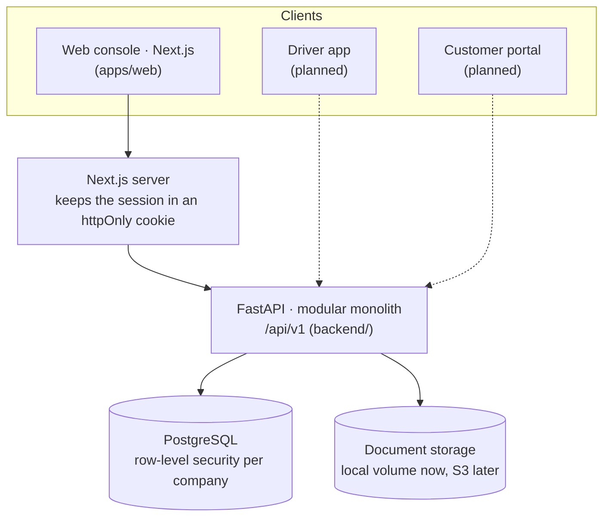

# FlyFleet

**[flyfleet.io](https://flyfleet.io)**

A web-based transportation management system (TMS) for trucking companies, built as multi-tenant software
from day one. One owner profile can run **up to ten companies**, each with its own books, and switch between
them in one click.

> **Status.** The API covers everything in the table below. The web console is **Design 1.0**: the FlyFleet
> design, screen for screen, running on the API. Every record on screen is the signed-in company's own; a new
> company starts empty. Progress is tracked in [docs/roadmap.md](docs/roadmap.md).

## The web console today

The console at app.flyfleet.io is built on the FlyFleet design system, in light and dark, with the role of
the signed-in person deciding what they see. It reads and writes everything through the API.

| Area | Screens |
| --- | --- |
| Overview | Role-aware dashboard: the next four hours, what needs attention one row per alert or paperwork with its own action (acknowledge, assign, request the POD from the driver), deliveries with their ETA, the live fleet, and financials or a billing overview for roles that may see money; My tasks (from fleet alerts and teammates, most urgent first) |
| Operations | Dispatch board with the assignment panel (eligibility and conflicts from the API), Loads with the detail drawer, the load's page with every lifecycle action, the guided new-load form, Live fleet (the map with each truck's position, freshness, load, ETA, trail and alert), Fleet alerts (one incident per episode, acknowledged, assigned and resolved), Messages (conversations with drivers, customers and teammates, what reached them by which channel, the load and alert beside the conversation, suggested replies when the assistant is on) |
| Directory | Customers, Drivers and the driver profile (the qualification file item by item with where each date came from and the reminders sent, asking the driver for a document, records kept by hand, documents, loads, location and who sees it, activity from the audit log, sensitive details revealed on request and logged) |
| Safety and fleet | Compliance (each driver's CDL, medical card and qualification file item by item, trucks, trailers and the company's own documents, with figures that filter, the review queue with where each document came from and how sure its reading is, the reminder schedule and its rules, and export), Inspections, Documents (needs review, processing, failed, approved and rejected, filtered by type, record and uploader, searched by file, load or person, with where each came from, its pages and how sure its reading is, and upload from the inbox) and document review (the pages with what was read boxed on them, each field with its confidence and the checks against FlyFleet's records, every field confirmed, corrected with a reason or marked unreadable, then approve and attach), Trucks, Trailers and the unit record, Maintenance (the board from open through scheduled, in progress and waiting for parts to completed, with the return-to-service sign-off; the same work orders as a list and on a calendar; open and high-priority work, the unit off the road longest, average downtime against the month before, and the month's cost) |
| Finance and analytics | Invoices with receivables aging, driver pay and owner settlement statements, Fuel & IFTA (purchases with their checks, scanned receipts, miles by truck and state, the quarterly return through filing, tax rates), Reports with CSV export, the fuel report among them |
| Administration | Team & access (members; roles edited on a module-by-action grid, custom roles, one person's exceptions, change history and an access review; invitations by link; dispatch teams with their dispatchers and trucks, truck coverage and a preview as the team's dispatcher), company settings, Integrations (each provider's state and figures, inbound events), Audit log (by kind, with details and export) |
| Everywhere | Search (⌘K), notifications, Create and edit forms for drivers, trucks, trailers, customers, inspections, invoices, payments, statements, fuel and work orders |
| Outside the console | Sign-up, sign-in, choosing and switching company |

Screens of the design that have nothing behind them in the API yet show an empty state that says so: Ask
FlyFleet and the platform operator's area.

How it is built: [apps/web/README.md](apps/web/README.md).

## What the API does today

| Area | Included |
| --- | --- |
| Account and companies | Sign-up, one profile with up to 10 active companies, add a company by copying team, terminals, customers, drivers and equipment from another, archive (read-only) and restore, one-click switch |
| Team and access | Main Admin and Administrator with full access, fixed; Dispatcher (no money, compliance or invoices unless granted), Safety Manager, Fleet Manager, Accounting and Read-only as templates a company can change for itself, and custom roles made from them, laid out by module and action; one person's allowances and denials (a denial always wins); full-access roles and team management can't be handed out or changed; permissions resolved on every request, so changes apply at once; invitations by a link that sets up the sign-in (or adds the company to an existing one) and can be renewed or withdrawn, including drivers to the driver app; an access review with export; password change with session revocation; audit log by kind with export |
| Dispatch teams | Teams of dispatchers and trucks (one team at a time for each); a team's dispatchers see only its trucks and the loads, drivers, positions and alerts tied to them, in lists, records, the dispatch board, search, the map, reports and counts, and can assign loads only to its trucks; unassigned loads tagged for the team or the shared queue; what a dispatcher on no team sees; a read-only preview of a team's view for those who manage the team; every change in the audit log |
| Directory | Customers with contacts and addresses, drivers with qualification files and pay settings, trucks, trailers, terminals. Licence numbers are encrypted and masked by role |
| Loads | Drafts, multi-stop routes, freight items, accessorial charges, notes, check calls, one enforced lifecycle with an immutable history, optimistic concurrency; the list shows each load's papers, its ETA against the appointment and why it is held, with saved views, status changes in bulk, bills of lading as a PDF, and loads imported from a spreadsheet as drafts |
| Dispatch | Board with server-side filters, sorting and paging, summary counts, saved views, eligibility with reason codes, schedule-overlap checks, safe assignment under concurrency, reassignment history |
| Documents | Upload by intent, upload, complete (ready for S3 presigned URLs), content checks, pages counted and the paper read on arrival when it is a kind FlyFleet reads, links to any record or the company itself, review with each field's decision kept beside what was read, approval that renews the record or, for a proof of delivery, completes the load, role-restricted licence, medical and test-result scans |
| Safety | Compliance status on every driver and unit; a qualification file each company sets (the annual MVR review and clearinghouse query, the road test and the pre-employment drug test as standard), whose items keep a driver off loads while missing or run out unless the company says otherwise; the company's own documents (authority, insurance, UCR, IFTA licence); expirations queue; blocking at assignment and at dispatch; an approved replacement renews the record it is filed with; expiry reminders once a night at the company's hour, once per item and window, to the driver by the channels chosen and as a task for the safety team, sent from `scripts/run_reminders.py` on a schedule and caught up when the compliance pages are read; the matrix as CSV |
| Maintenance | Work orders with parts and labour costs, start, wait for parts (with the date they are due) and resume, complete and cancel; inspections with defects; out-of-service units kept off the dispatch board until signed back into service, which is refused while the repair is open, and the repair remembers who signed it off; downtime per repair over 30 days |
| Finance | Draft invoices built from completed loads, gapless numbering at issue, immutable issued invoices, void, payments with allocations, unapplied money, reversal, receivables aging |
| Costs and driver pay | Expenses with receipts (fuel with gallons and state, tolls, lumpers, advances and more), fuel by state for fuel tax and by truck with miles per gallon, driver settlements built from delivered loads, driver-payable charges, reimbursements and deductions, approved settlements fixed by the database |
| Fuel tax (IFTA) | Diesel rates per quarter, entered or imported from the tax matrix; miles by truck and state from trips entered by hand (checked against the odometer) or imported from a spreadsheet (optionally held for review); the quarterly return worked out live, then reviewed, approved with its lines fixed, filed and paid, with CSV and PDF exports; each purchase checked against the load the truck was on and its tank; receipts read from a PDF or photo into purchases |
| Live fleet and alerts | Truck positions from telematics integrations or the driver app (deduplicated), read back as the live fleet with freshness, place names, loads and ETAs, and as trails; speed rules that raise one incident per episode; alerts kept in step with the records (late and at-risk appointments, loads with no driver, missing PODs, dwell, trucks gone quiet, units out of service, expired paperwork); who was told and how, escalation, acknowledge, assign, resolve; versioned alert policies with a preview on real positions; geofences |
| Messages | One conversation per driver, conversations with a customer or one of their contacts, team conversations; every message kept with its delivery on each channel (sent, delivered, read, or not sent and why); the driver app collects its messages from the API; dispatched loads and alerts sent to a driver appear as cards in their conversation, and a driver's reply goes on the alert's trail; unread counts; suggested replies through the Anthropic API when turned on, never sent on their own |
| Tasks | Tasks for oneself or a teammate with a due time and priority; a fleet alert gives its owner a task that follows the alert when it changes hands and closes when it clears or, for speeding, when acknowledged |
| Insight | Role-aware dashboard, exceptions list, global search, revenue, driver, truck, aging and fuel reports with CSV export |
| Driver access | A driver sees and updates only the loads they are hauling, can add the proof of delivery, and has their conversation with the office |

Not built yet: the driver mobile app, the website, ELD, and the AWS infrastructure. In the API: the customer
portal, IFTA miles by state from GPS positions and the assistant panel. The console shows those screens empty
until they exist.

## Architecture in one minute



- **One backend, separate modules**: `organizations`, `customers`, `drivers`, `equipment`, `loads`,
  `dispatch`, `documents`, `safety`, `finance`, `reports`.
- **A company is the unit of isolation, enforced by the database.** The API connects as a restricted role
  and PostgreSQL row-level security hides every other company's rows, including other companies under the
  same owner. The API refuses to start if its database role could bypass these rules.
- **FastAPI owns the rules.** Status changes, eligibility, money and permissions are decided on the server;
  the web app only presents them.
- **The browser never holds the API token.**

Details: [docs/architecture.md](docs/architecture.md). Decisions and their reasons:
[docs/decisions](docs/decisions).

## Run it

You need Docker, and for development Python 3.12 or newer (developed on 3.13) and Node.js 22.

Run these on the computer where you want to use the app: `localhost` in the addresses below means that
machine.

### Trying it

The console needs the API and its database. The quickest way to have all three is the next section; then
create an account at http://localhost:3000/signup, or run `make seed` to create a demo company with sample
records through the API (development only: it prints the sign-in it made).

### Everything in containers

```bash
docker compose --profile app up --build
```

The console is at http://localhost:3000 and the API documentation at http://localhost:8000/api/docs.

### For development (hot reload)

Start PostgreSQL (creates both database roles and the `flyfleet` and `flyfleet_test` databases):

```bash
docker compose up -d
```

Start the API:

```bash
cd backend
python -m venv .venv && source .venv/bin/activate
pip install -r requirements-dev.txt
alembic upgrade head
uvicorn app.main:app --reload --port 8000
```

Start the web app in a second terminal:

```bash
cd apps/web
npm install
npm run dev
```

Load a demo account: two companies, loads at every stage, invoices and payments, work orders and
inspections, fuel and other expenses, and driver pay (one settlement approved, one draft). It prints the
sign-in details:

```bash
cd backend && source .venv/bin/activate
python scripts/seed_demo.py
```

`make help` lists shortcuts.

## Test it

```bash
cd backend && pytest
```

The backend suite runs against a real PostgreSQL (the `flyfleet_test` database) and connects as the restricted
application role, so tenant isolation is tested exactly as it runs in production. It covers isolation at the
API and SQL level, the load lifecycle, assignment under concurrency, documents, invoicing and payments,
permissions for every role, and the API contract.

```bash
cd apps/web && npm run lint && npm run typecheck && npm test
```

End-to-end, in a real browser, against a built and running web app (first time only:
`npx playwright install chromium`):

```bash
cd apps/web && npm run build && npm run start
```

```bash
cd apps/web && npm run e2e
```

## Configuration

Backend (`backend/.env`, see `backend/.env.example`):

| Variable | Purpose |
| --- | --- |
| `FLYFLEET_DATABASE_URL` | Runtime connection. Must be the restricted role (`flyfleet_app`), never an owner or superuser |
| `FLYFLEET_MIGRATION_DATABASE_URL` | Schema owner (`flyfleet_owner`), used only by Alembic |
| `FLYFLEET_JWT_SECRET` | Token signing key. Required when `FLYFLEET_ENV=production` |
| `FLYFLEET_FIELD_ENCRYPTION_KEYS` | Keys that encrypt driver licence numbers. Required in production. Back them up: without them the values can't be recovered |
| `FLYFLEET_ENV` | `development`, `test` or `production` |
| `FLYFLEET_SIGNUP_ENABLED` | Set to `false` to turn off self-service sign-up |
| `FLYFLEET_MAX_COMPANIES_PER_ACCOUNT` | Active companies a new account may hold. Default 10 |
| `FLYFLEET_STORAGE_DIR` | Where uploaded documents are stored |
| `FLYFLEET_MAX_UPLOAD_BYTES` | Largest accepted upload. Default 15 MB |
| `FLYFLEET_DOCUMENT_READER` | `off` (default): when adding a record from a document, PDFs with a text layer are read by the built-in reader. `anthropic`: photos and scans are read by Claude through the Anthropic API, using `ANTHROPIC_API_KEY` |
| `FLYFLEET_DOCUMENT_READER_MODEL` | The Claude model the photo reader uses. Default `claude-opus-5-5` |
| `FLYFLEET_ASSISTANT` | `off` (default): no suggested replies in Messages. `anthropic`: Claude drafts a reply to the latest message from a driver or customer, through the Anthropic API using `ANTHROPIC_API_KEY`. A person reviews every draft; nothing is sent automatically |
| `FLYFLEET_ASSISTANT_MODEL` | The Claude model suggested replies use. Default `claude-opus-5-5` |
| `FLYFLEET_CORS_ORIGINS` | Only needed for browser clients that call the API directly |

Web (`apps/web/.env.local`, see `apps/web/.env.example`):

| Variable | Purpose |
| --- | --- |
| `FLYFLEET_API_URL` | Where the Next.js server reaches the API. Default `http://localhost:8000` |
| `FLYFLEET_ALLOW_EMBEDDING` | `true` lets the app be shown inside another site's frame, for hosted preview panes. Off by default; never enable in production |

## Repository layout

```
apps/web/            The web console, Next.js (see apps/web/README.md)
backend/
  app/core/          Config, database and tenancy, auth, permissions, errors, paging, idempotency, storage
  app/modules/       One package per business module: models, schemas, router, and service where rules live
  alembic/           Migrations: 0001 schema, 0002 row-level security, grants, guards and sign-in functions
  scripts/           Demo data, and the export of the API contract the web types are generated from
  tests/             API and SQL-level tests
infrastructure/      Docker assets (Terraform will live here)
docs/                Architecture, decisions, roadmap, the implementation audit
```

## Known limitations

- **Some screens of the design have no API yet** (the assistant panel, the platform operator's area). They show
  an empty state saying so, never sample data.
- **Invitations are links, not emails.** No email provider is connected, so whoever invites copies the link and
  sends it. A link works once, for a week.
- **No telematics provider or messaging channel is connected yet.** Positions come in through the API
  (`POST /api/v1/positions` for an integration, `POST /api/v1/driver/positions` for the driver app). Alerts
  reach people in the app, and drivers in the driver app's inbox (`GET /api/v1/driver/messages`); Telegram,
  SMS, email and push are recorded on each incident and message as not sent. Messages to customers need email,
  so none are sent until it is connected; a driver not signed up to the driver app can't be messaged yet.
- **Map and place data**: state and national outlines from the US Census Bureau (via `us-atlas`) and Natural
  Earth (via `world-atlas`), both public domain; place names from GeoNames (geonames.org, CC BY 4.0). The
  interstates on the map are schematic lines through the cities they connect, not road geometry.
- **IFTA miles come from trips entered by hand and imports** until a telematics provider can be connected;
  fuel cards are not connected yet either, so purchases are scanned or typed in.
- **Sign-in is local email and password** with signed tokens. Cognito, MFA, password reset by email and
  invitations by email are deferred to the deployment phase
  ([decision 0003](docs/decisions/0003-local-adapters-until-deployment.md)). An administrator sets a
  temporary password for a new person; someone who already has a FlyFleet sign-in is simply given access.
- **Login throttling is per API process.** Real rate limiting belongs at the edge.
- **Documents are stored on a local volume** behind a storage interface, and are not scanned for malware.
- **No background jobs.** Reminders and notifications need a worker; expirations are worked out when read.
- **One currency per company.** Currency is stored on every load, invoice and payment, but nothing converts.
- **Reports cover one company.** A view across all of an account's companies is not built.
